# Germanium / COSI toy detector plot archive

All plots generated during the toy-detector study on 2026-11-13 are preserved here: **13 figures, each as PNG and PDF, plus seven self-contained HTML viewers**. PNG previews appear below; PDFs are available beside each PNG. Download HTML files to view them locally; GitHub does not render these viewers directly.

Transport used native MEGAlib 4.91 Cosima / Geant4 11.2.2, from MEGAlib commit `906cd474` on `develop-cosi`. Reconstruction comparisons call compiled native Revan library classes; the earlier truth-assisted analysis is Python. This archive is based on the fork's `main` branch and does not change MEGAlib source code. Original figures are copied without modification; `manifest.json` records their sizes and SHA256 checksums, together with supporting statistics and provenance files.

## How the versions differ

| Directory | Detector and reconstruction | Selection / interpretation |
| --- | --- | --- |
| `ge_square/` | Initial bare 5 × 5 × 2 cm Ge block; Python truth-assisted two-hit ordering | Clean truth-selected full-containment sample; historical starting point |
| `cosi_toy16/results/` | 16 × 16 × 16 cm Ge cube, five-sided 2 cm BGO shield; Python truth-assisted first pair, including >2 hits | Photopeak and truth-quality selections; benchmark compares native classic Revan with the truth shortcut |
| `cosi_toy16/revan4/` | Native classic Revan, 2–4 readout hits, no clustering, KN-only two-hit ambiguity handling | Energy spectrum uses broad selection; CDS and truth-angle plots use measured 657–667 keV photopeak; no ARM cut |
| `cosi_toy16/revan4/no_photopeak/` | Same native classic reconstruction | Photopeak cut removed; Ge trigger, BGO veto and first-pair cuts retained; no ARM cut |
| `cosi_toy16/dc3_reco/` | Native adjacent clustering and classic versus Bayesian Revan; 2–7 clustered sites | No photopeak or ARM cut; matched preprocessing and common timing input sample |

**Bayesian response caveat:** the requested DC3 configuration's private response family was unavailable. The Bayesian figures use the DC3 algorithm/clustering settings with the **published DC2 Bayesian response tables**, not the exact DC3 response and not a validated response for this monolithic toy geometry. The classic comparison retains the earlier KN-only ambiguity rule. The rejected experimental toy-trained response is not used in these plots or archived final statistics. See [the comparison provenance](cosi_toy16/dc3_reco/README.txt) and [response manifest](cosi_toy16/dc3_reco/reference_dc2/manifest.json).

The 16 cm toy has 1 mm virtual x/y strip pitch, 0.5 mm sigma depth smearing, and per-hit Gaussian energy sigma interpolated through (0 keV, 0.3 keV), (662 keV, 0.85 keV), (2000 keV, 1.4 keV). It has a 2 mm Ge/BGO gap and an open +z face. The ideal BGO veto rejects any panel depositing ≥50 keV; the Ge trigger requires a raw channel deposit ≥10 keV. This is a gamma-only study, without charge transport, pile-up, dead time, or validated charged-particle veto response.

Effective areas in `revan4/` use all 100,000 incident 662 keV photons from a radius-15 cm disk covering the entire footprint. Earlier central-illumination, truth-selected plots should not be interpreted as the same efficiency measurement. Timings measure the documented in-memory operations, not the complete COSI pipeline. Original notes contain environment-specific reproduction paths; simulation inputs and event datasets are not bundled in this plot archive.

## Figure gallery

### Initial bare germanium detector

**compton data space** — [PNG](ge_square/results/compton_data_space.png) · [PDF](ge_square/results/compton_data_space.pdf)

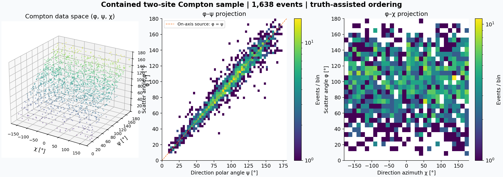

**detector and energy** — [PNG](ge_square/results/detector_and_energy.png) · [PDF](ge_square/results/detector_and_energy.pdf)

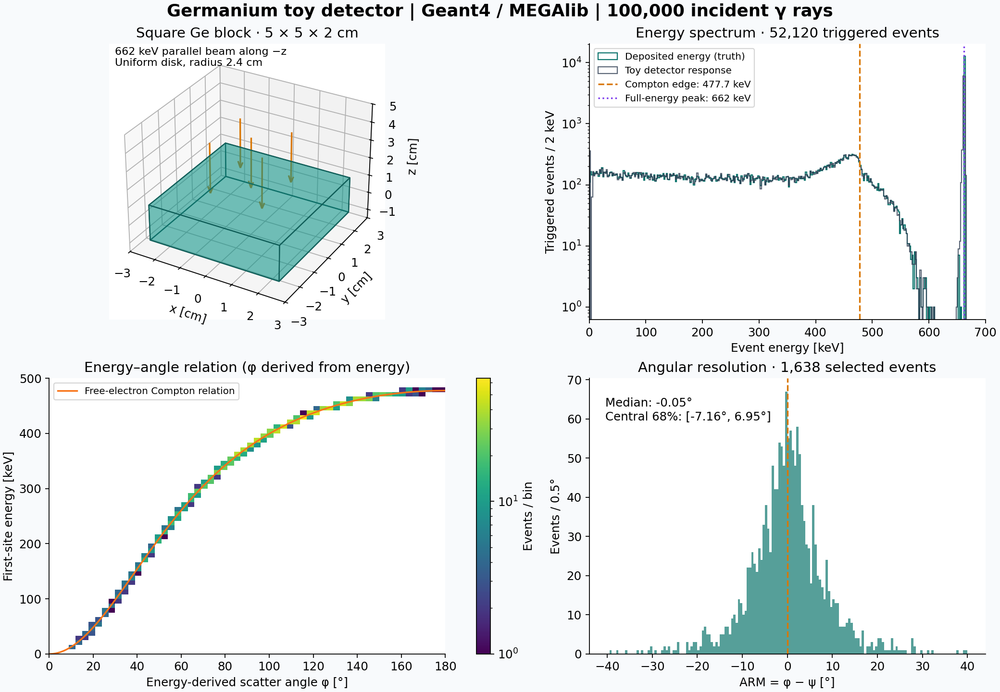

### 16 cm Ge + BGO: truth-assisted reconstruction and benchmarks

**compton data space** — [PNG](cosi_toy16/results/compton_data_space.png) · [PDF](cosi_toy16/results/compton_data_space.pdf)

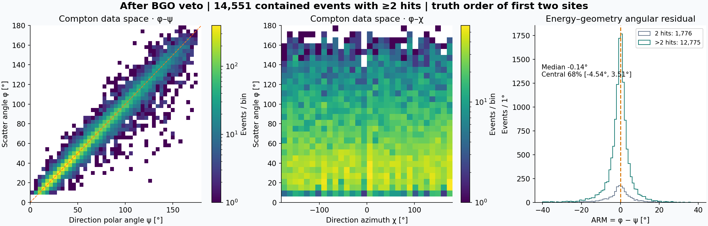

**geometry energy veto** — [PNG](cosi_toy16/results/geometry_energy_veto.png) · [PDF](cosi_toy16/results/geometry_energy_veto.pdf)

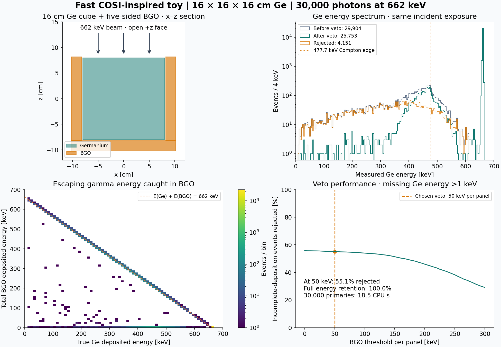

**multihit benchmark** — [PNG](cosi_toy16/results/multihit_benchmark.png) · [PDF](cosi_toy16/results/multihit_benchmark.pdf)

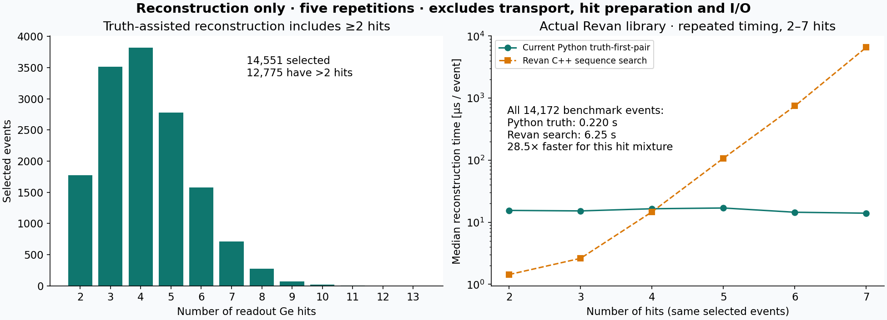

### Classic Revan: 2–4 hits, photopeak CDS / angle comparison

**compton data space** — [PNG](cosi_toy16/revan4/compton_data_space.png) · [PDF](cosi_toy16/revan4/compton_data_space.pdf)

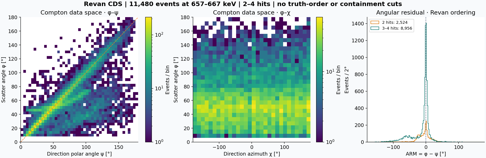

**energy and effective area** — [PNG](cosi_toy16/revan4/energy_and_effective_area.png) · [PDF](cosi_toy16/revan4/energy_and_effective_area.pdf)

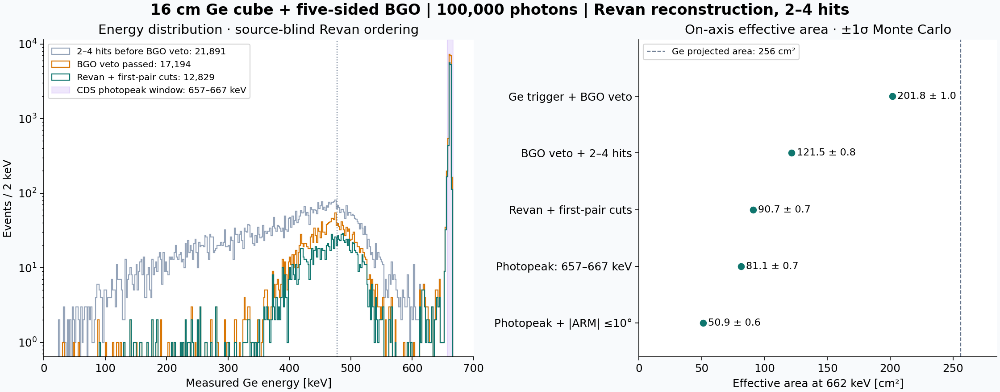

**true vs reco compton** — [PNG](cosi_toy16/revan4/true_vs_reco_compton.png) · [PDF](cosi_toy16/revan4/true_vs_reco_compton.pdf)

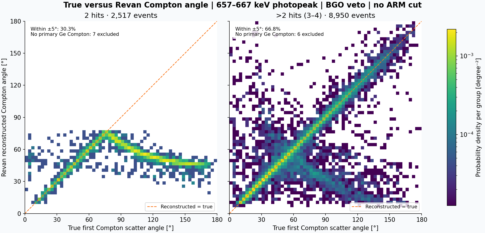

### Classic Revan: photopeak cut removed

**compton data space** — [PNG](cosi_toy16/revan4/no_photopeak/compton_data_space.png) · [PDF](cosi_toy16/revan4/no_photopeak/compton_data_space.pdf)

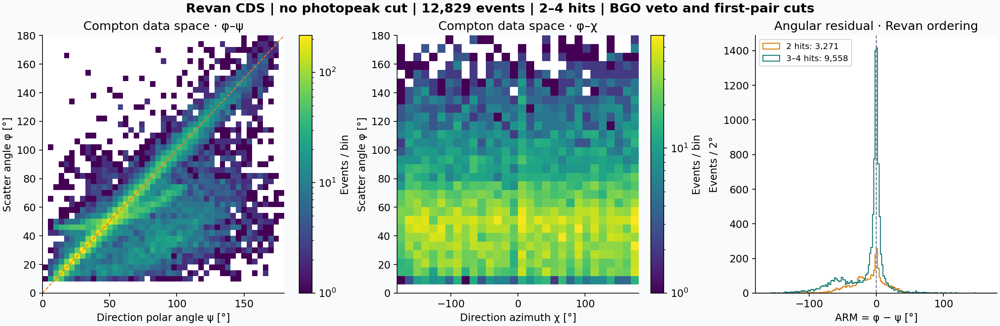

**true vs reco compton** — [PNG](cosi_toy16/revan4/no_photopeak/true_vs_reco_compton.png) · [PDF](cosi_toy16/revan4/no_photopeak/true_vs_reco_compton.pdf)

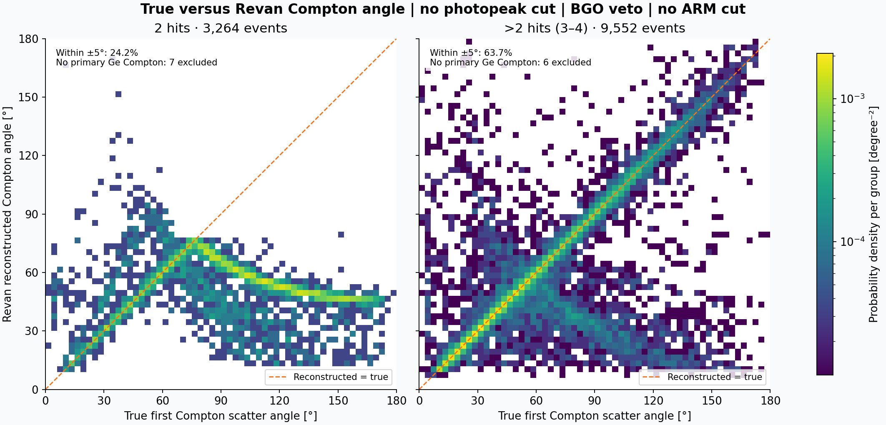

### Clustered classic / Bayesian comparison: 2–7 sites

**bayes cds** — [PNG](cosi_toy16/dc3_reco/bayes_cds.png) · [PDF](cosi_toy16/dc3_reco/bayes_cds.pdf)

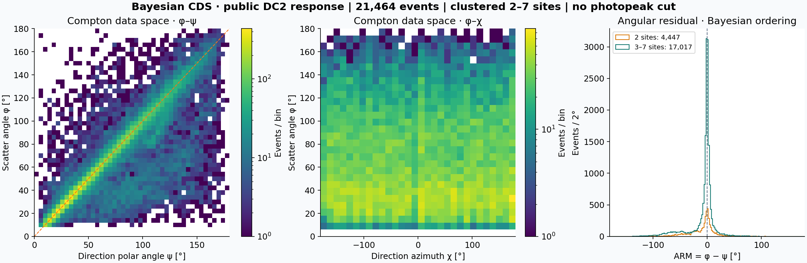

**energy and timing** — [PNG](cosi_toy16/dc3_reco/energy_and_timing.png) · [PDF](cosi_toy16/dc3_reco/energy_and_timing.pdf)

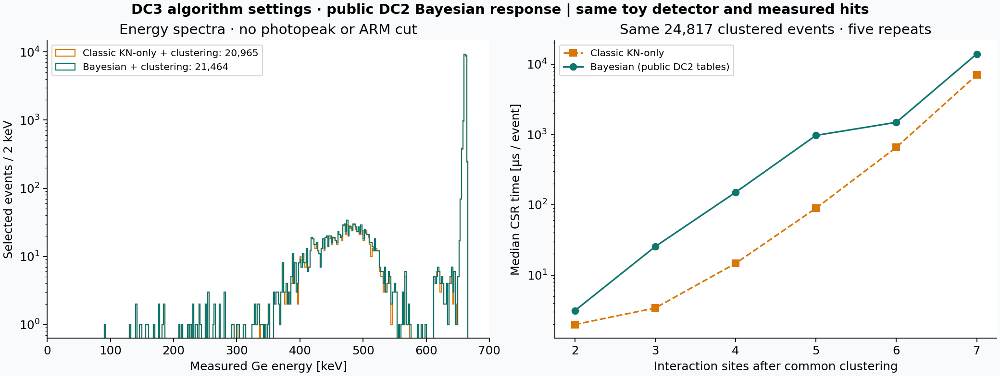

**true vs reco comparison** — [PNG](cosi_toy16/dc3_reco/true_vs_reco_comparison.png) · [PDF](cosi_toy16/dc3_reco/true_vs_reco_comparison.pdf)

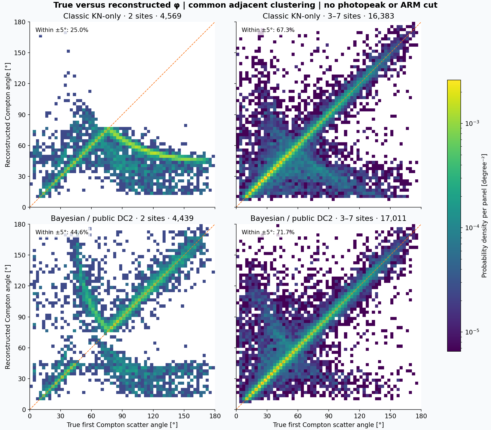

## HTML viewers

- [cosi_toy16/cosi-ge-bgo-plots.html](cosi_toy16/cosi-ge-bgo-plots.html)
- [cosi_toy16/cosi-multihit-compton.html](cosi_toy16/cosi-multihit-compton.html)
- [cosi_toy16/dc3_reco/bayesian-classic-comparison.html](cosi_toy16/dc3_reco/bayesian-classic-comparison.html)
- [cosi_toy16/revan4/no-photopeak-compton-plots.html](cosi_toy16/revan4/no-photopeak-compton-plots.html)
- [cosi_toy16/revan4/revan-energy-cds-area.html](cosi_toy16/revan4/revan-energy-cds-area.html)
- [cosi_toy16/revan4/true-vs-reconstructed-compton.html](cosi_toy16/revan4/true-vs-reconstructed-compton.html)
- [ge_square/germanium-plots.html](ge_square/germanium-plots.html)
