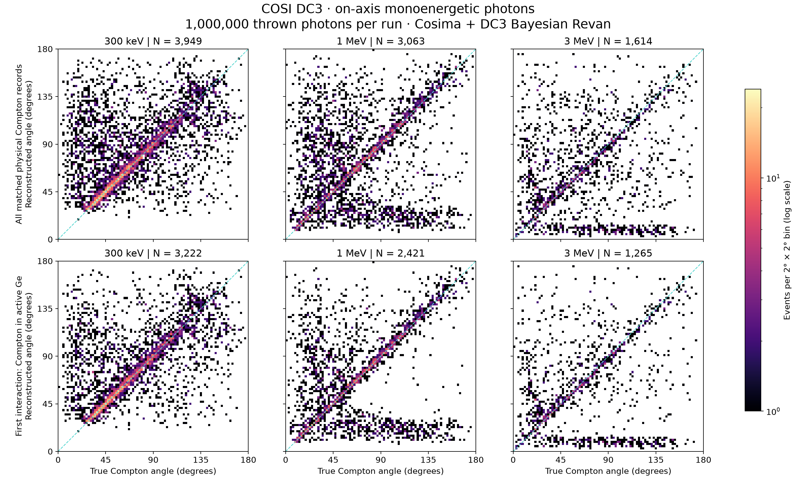
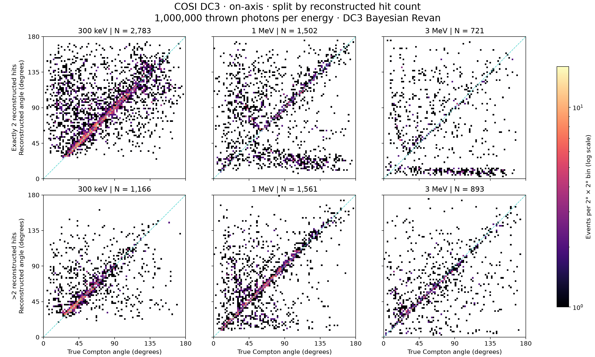
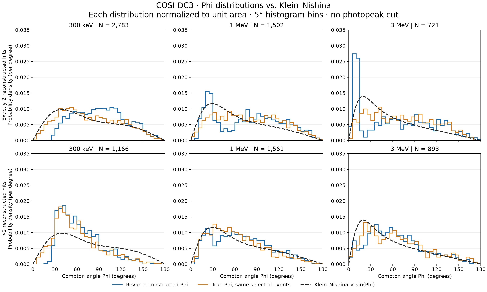
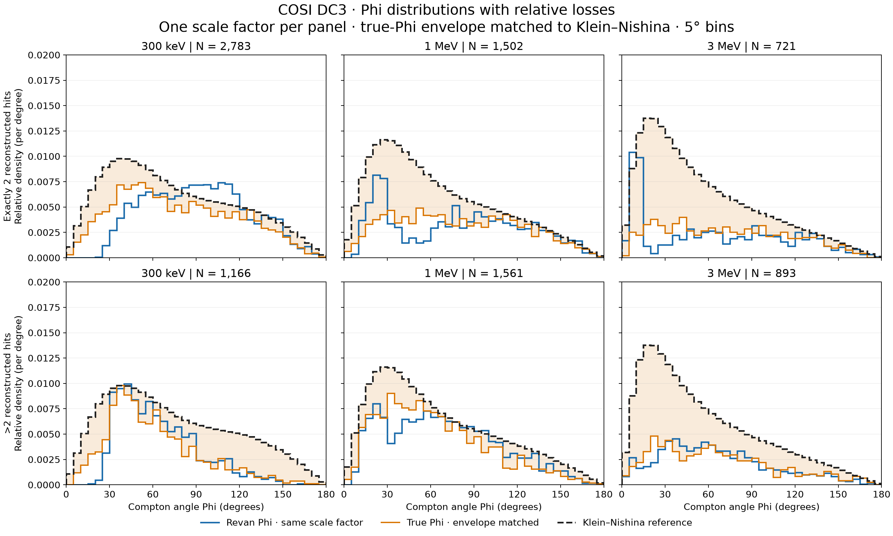
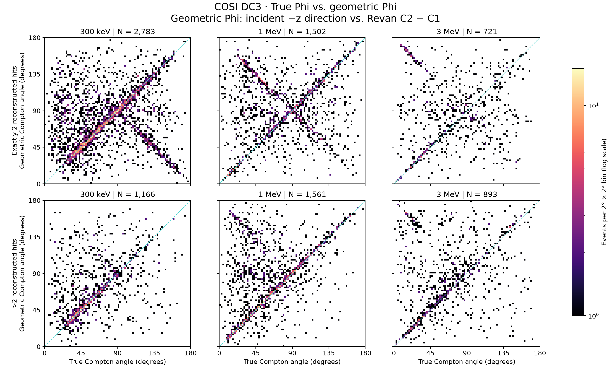
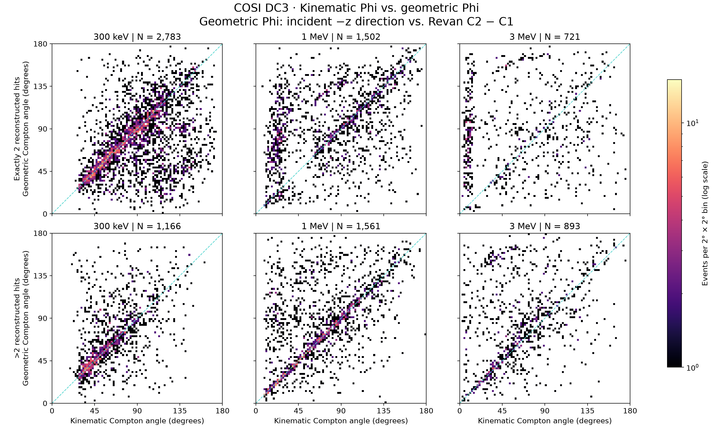
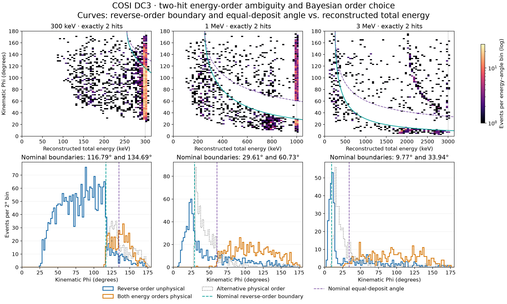
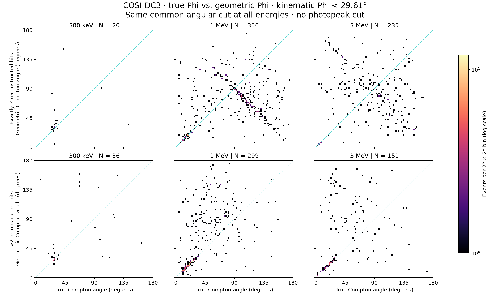
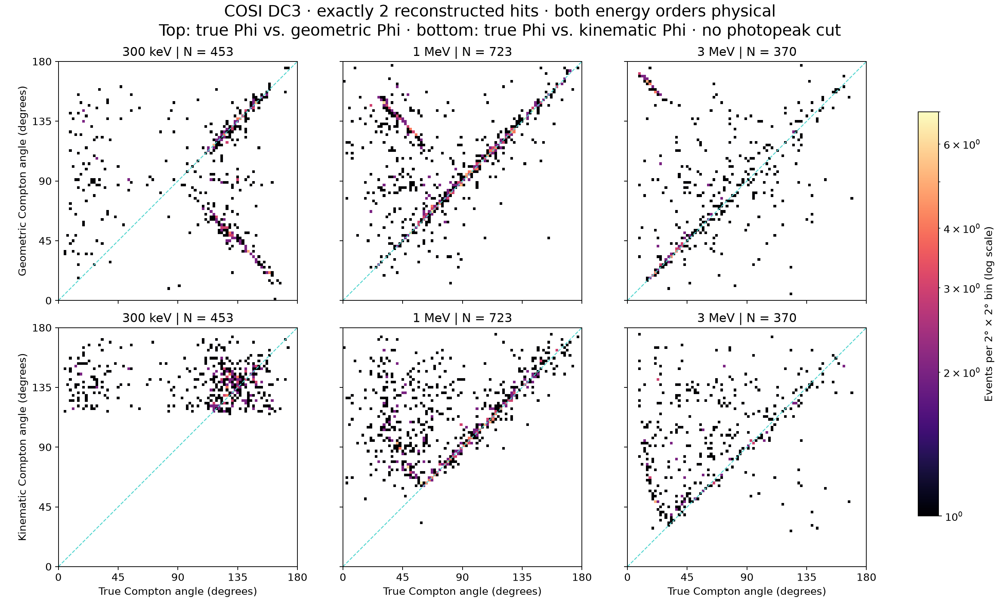

# COSI DC3 on axis Compton angle study

This study compares true, kinematic and geometric Compton angles for monoenergetic COSI DC3 simulations at **300 keV, 1 MeV and 3 MeV**, with **1,000,000 on-axis photons per energy**. Cosima supplies the transport simulation; **DC3 Bayesian Revan is the only event reconstruction algorithm**. Results are split by exactly two and more than two reconstructed interaction sites.

The selected sample contains 3,949, 3,063 and 1,614 truth-matched Compton events at the three energies. The figures show a diagonal population together with substantial tails. The true-angle distribution of selected events differs from the free-electron Klein–Nishina distribution because detector response, event selection and hit multiplicity condition that sample. The relative-loss normalization below illustrates deficits in shape; it does not measure absolute efficiency.

Last updated: **2026-11-16**. Branch: `reports/cosi-dc3-onaxis-compton`. This is the working report for subsequent requested analyses in this conversation.

## Simulation and reconstruction

| Setting | Value |
| --- | --- |
| Primary photons | 1,000,000 per energy; no polarization specified |
| Source | `FarFieldPointSource 0 0`; propagation along detector −z |
| Energies and Cosima seeds | 300 keV: 30101; 1 MeV: 100101; 3 MeV: 300101 |
| Physics | `LivermorePol` |
| Simulation geometry | `COSISMEX.sim.geo.setup`, with `COSISMEX.Ge.SimsOnly.det` |
| Reconstruction geometry | `COSISMEX.analysis.geo.setup`, with `COSISMEX.Ge.O64.det` |
| Revan settings | DC3 configuration; `CSRAlgorithm=4` (Bayesian), `HitClusteringAlgorithm=2`, maximum 7 interactions |
| Added atmosphere or background | None |
| Energy selection | No photopeak window |
| Density histogram bins | 2° × 2°, logarithmic event counts |
| One dimensional histogram bins | 5° |

The simulation and analysis setup files differ in their germanium detector-response include. Revan applies the analysis geometry's thresholds, resolution and hit processing to the simulation data. The analysis detector definition has an 18 keV trigger threshold and an 1800 keV overflow setting; these are model parameters, not cuts added by the plotting scripts.

The supplied [mass model](https://github.com/cositools/massmodel-cosi-dc3) and [DC3 configuration](https://github.com/cositools/cosi-sim/tree/main/cosi_sim/Input_Files/Configuration_Files/Data_Challenges/Data_Challenge_3) are preserved under [inputs](inputs/). The Bayesian response path is resolved locally, while Revan's `-g` and `-f` options override the configuration's legacy geometry and data paths. [The effective configuration used for the archived runs](runs/original-effective.revan.cfg) retains the original working paths as provenance.

| Component | Recorded version or commit |
| --- | --- |
| MEGAlib | 4.91.00; base commit `906cd47428f7fd02df4564b5e61e46cb2949c89f` |
| ROOT | 6.38.04 |
| Geant4 | 11.2.2 |
| Mass model | `09d6feee24c9afb83a4602f1cd58fdf5f6c6f0e7` |
| cosi-sim | `6a6c0b3432ec2e1af23a141f5a5df3f3b10cd85f` |

Cosima seeds were recorded explicitly. No independent Revan random seed was recorded. Exact archived event selections can be reproduced by reading the saved TRA files; a fresh simulation and reconstruction is not claimed to be bitwise identical. SIM/TRA headers contain a `1970-01-01` Date field, so that field is not used to date the runs. The primary runs were performed on 2026-11-13, with subsequent plot updates on November 13–14.

## Angle definitions and event selection

**True Phi** is the angle between the simulated primary photon's incoming and outgoing directions at its first `COMP` interaction. This definition includes scatters in passive material. If a recorded primary interaction precedes that Compton scatter, its outgoing photon direction provides the incoming direction. The optional direct-germanium subset requires the first primary interaction to be `COMP` in active germanium, detector type 3.

**Kinematic Phi** is `MComptonEvent.Phi()` from Revan. Revan determines the interaction sequence and energies. The initial plotting implementation independently evaluated the standard Compton energy formula only as a reader check; it was not a second reconstruction algorithm. All archived final figures use MEGAlib's `Phi()` directly:

`cos(Phi_kin) = 1 − 510.99895 keV × [1/E_gamma − 1/(E_e + E_gamma)]`.

**Geometric Phi** is the angle between the known incident direction `(0, 0, −1)` and Revan's first-to-second reconstructed position vector, `C2 − C1`. It uses the reconstructed ordering, not truth ordering. For events that scatter in passive material before the detected sequence, this source-axis angle need not equal the local true scatter angle.

The saved SIM and TRA records are joined by stored event ID. The plotted sample requires a Compton event with `IsGoodEvent() == true` and a matching first primary-photon Compton scatter in the SIM truth. Hit count is Revan's `SequenceLength()`, after clustering; it is not the number of raw simulation deposits or detector strips. The geometric comparisons keep exactly the same events; none had coincident first and second reconstructed positions.

### Validation of written Compton records

The MEGAlib kinematics check rejects unphysical Compton cosines. However, a written `ET CO` record is not by itself evidence that `IsGoodEvent()` will pass. In this base revision, [`MRERawEvent::GetPhysicalEvent()`](../../../src/revan/src/MRERawEvent.cxx) calls `m_Event->Validate()` without acting on its returned value, and [`MRawEventAnalyzer`](../../../src/revan/src/MRawEventAnalyzer.cxx) can write the resulting event. [`MComptonEvent::Validate()`](../../../src/global/misc/src/MComptonEvent.cxx) rejects invalid kinematics when the TRA reader validates the record.

Pilot TRA event 23 has `E_e = 14.867 keV` and `E_gamma = 43.1001 keV`; MEGAlib reports `IsKinematicsOK() = false`, `Validate() = false` and `IsGoodEvent() = false`. It is excluded. The reader check agreed with MEGAlib's reconstructed Phi for all 45 plotted pilot events. A separate truth-direction check against the vector to the next primary interaction agreed within 0.034° for 105 pilot events, consistent with saved position/direction precision.

### Event accounting

| Stage | 300 keV | 1 MeV | 3 MeV |
| --- | ---: | ---: | ---: |
| Thrown photons | 1,000,000 | 1,000,000 | 1,000,000 |
| Stored SIM events | 12,300 | 10,955 | 9,480 |
| Revan Compton records | 4,099 | 3,228 | 1,902 |
| Compton records failing `IsGoodEvent()` | 145 | 161 | 104 |
| Good Compton records without matching primary COMP truth | 5 | 4 | 184 |
| Plotted events | **3,949** | **3,063** | **1,614** |
| Exactly 2 reconstructed hits | 2,783 | 1,502 | 721 |
| More than 2 reconstructed hits | 1,166 | 1,561 | 893 |
| Direct first Compton interaction in active Ge | 3,222 | 2,421 | 1,265 |

Stored SIM events and Revan Compton records refer to different processing stages. In particular, the simulated detector definition and Revan's analysis detector definition are different. The excluded truth-unmatched population is recorded explicitly; no process attribution has been assigned to it here.

## True and kinematic angles

The first comparison shows true Phi on x and reconstructed kinematic Phi on y. The upper row contains all plotted events; the lower row restricts the first primary interaction to a Compton scatter in active germanium. The diagonal marks equal angles.



The following comparison uses the requested multiplicity split: exactly two reconstructed hits in the upper row, more than two in the lower row. Columns are 300 keV, 1 MeV and 3 MeV. Each figure uses one color scale across its panels.



The all-event median kinematic-minus-true residuals are 1.89°, 0.89° and −0.18°. The corresponding 68th percentiles of the absolute residual are 27.11°, 41.12° and 47.35°. These describe distributions with substantial tails and are **not Gaussian angular-resolution measurements**. Detailed values are in [summary.json](results/summary.json).

## Phi distributions and Klein Nishina

The reference is the free-electron Klein–Nishina cross section marginalized over azimuth. With `r = E'/E = 1/[1 + (E/511 keV)(1 − cos Phi)]`, its angle density is proportional to:

`r² × [r + 1/r − sin²(Phi)] × sin(Phi)`.

The final `sin(Phi)` is the solid-angle Jacobian. The numerical reference is normalized over 0–180° and expressed per degree. Its integrated cross section agrees with the analytic Klein–Nishina integral at all three energies to the numerical tolerance used by the script.

Each distribution below has unit area. Blue is Revan kinematic Phi; orange is true Phi for the same selected events; dashed black is the Klein–Nishina reference. The y-axis is 0–0.035 per degree in every panel, leaving every curve visible.



The selected true distribution is not an inclusive scattering distribution. Thresholds suppress low-energy deposits, while photon containment, escape, subsequent interactions, hit merging, hit multiplicity and reconstruction selection can change the accepted angular distribution. Passive-material scatters contribute to the main sample as well. These are explanations for the kinds of differences expected; their individual contributions have not been isolated by this analysis. Bound-electron effects also distinguish Livermore transport from a free-electron reference.

### Relative loss view

For each panel, a single factor is applied to both the true and reconstructed histograms. Starting with unit-area densities, let `K_i` be the bin-integrated Klein–Nishina density and `T_i` the true density. The scale is `s = 1 / max_i(T_i/K_i)`. Thus `s T_i` touches the expected histogram in the largest observed true-to-expected ratio bin. Shading shows `K_i − s T_i`. The reference is averaged over the same 5° bins, avoiding a center-value approximation near rapidly varying parts of the curve.



| Energy | Hit class | Scale applied to true and reconstructed histograms | Reference bin | True events in reference bin |
| --- | --- | ---: | --- | ---: |
| 300 keV | 2 | 0.70723 | 125–130° | 93 |
| 300 keV | >2 | 0.53816 | 35–40° | 106 |
| 1 MeV | 2 | 0.52394 | 135–140° | 43 |
| 1 MeV | >2 | 0.71112 | 75–80° | 68 |
| 3 MeV | 2 | 0.37893 | 135–140° | 21 |
| 3 MeV | >2 | 0.36355 | 165–170° | 8 |

This normalization supplies a relative shape comparison, not an absolute efficiency or a measured zero-loss reference. It is sensitive to statistical upward fluctuations, especially the 8-event reference bin in the 3 MeV >2-hit sample. Factors are chosen independently by panel, so their magnitudes do not establish relative detection efficiencies between energies or hit classes. Reconstructed densities may exceed the reference because angular reconstruction moves events between bins. The plotted deficits remain conditional on the event selection and the chosen free-electron reference.

## Geometric angle comparisons

Both figures below use the same sample and share the same logarithmic color normalization, with 2° × 2° bins. The upper row has exactly two hits and the lower row has more than two. All geometric angles were checked against `event.Dg().Angle(incident_direction)` in MEGAlib; event IDs, kinematic angles and sequence lengths were also checked against the preceding analysis tables.

### True Phi and geometric Phi

True Phi is on x and geometric Phi is on y.



The diagonal is accompanied by a population near the opposite diagonal. Reversing a two-site vector maps an angle to approximately `180° − Phi`, which is consistent with an interaction-order contribution. The low-angle study below quantifies a spatial reversal signature; it does not assign raw interaction origins to reconstructed clusters.

### Kinematic Phi and geometric Phi

Kinematic Phi is on x and geometric Phi is on y.



Agreement and off-diagonal populations reflect the relationship between Revan's energy-based angle and its ordered spatial vector. This comparison uses the known source direction; it does not reconstruct the source direction from an individual event.

## Low kinematic Phi branch and the apparent 30 degree gap

The gap at approximately 30° in the 1 MeV two-hit sample is associated with **energy-order ambiguity and Bayesian sequence choice**, rather than a universal angular cut. The relevant boundaries depend on the measured total energy; missing energy shifts them. These statements concern a two-deposit full-absorption interpretation, which can itself be wrong for an event with multiple unresolved or missed interactions.

### Kinematic boundaries

Let `E = e + g` be the reconstructed total energy, with `e` assigned to the first electron deposit and `g` to the remaining photon. The reverse energy order has:

`cos(Phi_reverse) = 1 − m_e c² × [1/e − 1/E]`.

Requiring this cosine to reach −1 gives `e = m_e c² E / (m_e c² + 2 E)`. Substitution into the selected-order Compton formula yields the reverse-order boundary:

`Phi_boundary(E) = 2 asin[m_e c² / (2 E)]`, for `E ≥ m_e c²/2`.

Below that angle, only the selected energy order is physical under the two-deposit model. Above it, both energy orders are physical. This analytic classification was checked against `MComptonEvent::IsKinematicsOK(g, e)` for every archived two-hit plotted event. For reconstructed energies below `m_e c²/2`, no selected angle admits two physical energy orders.

An additional boundary separates smaller and larger first deposits. For `e = g = E/2`, `Phi_equal(E) = acos[1 − m_e c²/E]`. Choosing `e ≥ g` places the reconstructed angle at or above this equal-deposit angle.

| Nominal incident energy | Reverse-order boundary for a full-energy event | Equal-deposit angle | Approximate first-scatter floor from an 18 keV deposit threshold |
| --- | ---: | ---: | ---: |
| 300 keV | 116.79° | 134.69° | 26.97° |
| 1 MeV | **29.61°** | **60.73°** | 7.85° |
| 3 MeV | 9.77° | 33.94° | 2.60° |

The threshold floor uses the ideal single-scatter relation before noise, merging or missed hits; it is not a hard cut on the saved reconstructed angles. In particular, the sparse 300 keV population below 30° is near its deposit threshold, whereas the 1 MeV 30° division is far above the ideal threshold floor.

### Sequence choice explains the valley

Of the 1 MeV two-hit events within ±2% of the incident energy, 484 admit both energy orders. Revan selects the larger first deposit in **481 of those 484 events**. In the same full-energy two-hit sample, 147 events fall below the common 29.606° cut, only 3 fall between that cut and the nominal 60.725° equal-deposit angle, and 481 lie at or above the equal-deposit angle. The alternative physical ordering of the high-angle events supplies angles in the otherwise depleted interval.

This is an observed preference of the configured Bayesian reconstruction, not an explicit `Phi = 30°` veto. [`MERCSRBayesian::ComputeQualityFactor`](../../../src/revan/src/MERCSRBayesian.cxx) scores the two-hit energy, cosine, attenuation distance and material against its good/bad response tables; [`MERCSR::ComputeAllQualityFactors`](../../../src/revan/src/MERCSR.cxx) evaluates permutations and the best score determines the saved sequence. The supplied angular response bins also have finite resolution in cosine. No ablation of the individual response factors was performed, so the specific learned likelihood term responsible for the preference is not isolated.



The upper panels show measured total energy versus kinematic Phi for two-hit events. The solid teal curve is the event-dependent reverse-order boundary, the dashed purple curve is the equal-deposit angle, and the dotted vertical line marks incident energy. The lower panels separate the selected events by whether the other energy order is physical; the gray dotted histogram shows that alternative angle for the events with two physical orders. The vertical markers are evaluated at nominal incident energy, so incomplete-energy events need not follow those fixed nominal markers.

### What populates the low angle branch

For the requested low-angle comparison, the same strict cut **`Phi_kin < 29.606366796°`** is applied at all three energies. It is derived from the nominal 1 MeV two-hit boundary; it is not claimed to be a universal ambiguity boundary, and the two-hit order argument does not apply directly to >2-hit sequences. The validation, truth matching and reconstructed hit-count definitions are unchanged. There is no photopeak cut in the figure.

| Quantity below the common cut | 300 keV, 2 hits | 1 MeV, 2 hits | 3 MeV, 2 hits |
| --- | ---: | ---: | ---: |
| Events | 20 | 356 | 235 |
| Reverse energy order unphysical | 20 | 356 | 232 |
| Kinematic minus true angle differs by more than 20° in magnitude | 2 | **271** | 202 |
| More than one primary-photon Compton interaction in the SIM history | 11 | **332** | 219 |
| True first COMP is near reconstructed C2 rather than C1 | 2 | **274** | 125 |
| Reconstructed energy within ±2% of incident energy | 19 | 147 | 6 |
| Simulated Ge deposit exceeds reconstructed energy by >50 keV | 0 | 1 | 132 |

The spatial signature in the table requires the first true primary Compton position to be within 3 mm of C2, and at least 0.5 mm closer to C2 than C1. It supports an ordering interpretation but is not an interaction-origin assignment for merged hits. The first-primary scatter can be in passive material under the main truth definition.

At 1 MeV, **108 of the 147 photopeak two-hit events below the cut** differ from true Phi by more than 20°. Of those 108, 105 have multiple primary Compton scatters, and 107 have the first true scatter near C2 rather than C1. Thus missing total energy alone does not explain the low-angle contamination: a two-hit reconstruction can represent a more complex true history, with unresolved, merged or missed interactions and a reversed spatial sequence. Passing kinematics under the two-deposit interpretation does not establish the correct physical order.

For example, stored **1 MeV event 41** has true Phi **121.51°** but reconstructed kinematic Phi **20.32°**. Its SIM history has **four primary Compton interactions**, and the total simulated Ge deposit is 1000 keV. Revan reduces it to two reconstructed hits with assigned first/remaining energies of **107.734 / 888.080 keV**, totaling **995.814 keV**. The first true Compton position is only **0.46 mm from C2**, compared with **8.55 mm from C1**. This is a concrete full-energy example of a complex interaction history represented by two hits and assigned a misleading low-angle, otherwise physical energy ordering.

At 3 MeV, only 6 of the 235 low-angle two-hit events have reconstructed energy within ±2% of incident energy. There are also substantial differences between the simulated Ge energy deposit and the reconstructed total. Sixty events have a reconstructed cluster at 1800 keV to within 0.1 keV, a sufficient but incomplete saturation signature because clustering can combine individual deposits. The configured overflow is applied by [`MDDetector::ApplyOverflow`](../../../src/geomega/src/MDDetector.cxx), and [`MDStrip3D::Noise`](../../../src/geomega/src/MDStrip3D.cxx) flags the overflow and loses depth information. These observations establish additional energy-response effects in this sample; they do not attribute every energy deficit solely to saturation rather than thresholds or other detector processing.

### True and geometric angles below the cut



The selected counts are **20 / 36**, **356 / 299**, and **235 / 151**, respectively, for two-hit / >2-hit events at 300 keV, 1 MeV and 3 MeV. The 1 MeV two-hit panel retains the opposite-diagonal population, consistent with the spatial ordering signature above. A smaller diagonal population remains. Event-level diagnostic fields are saved in the three `*.low_phi_diagnostics.csv.gz` tables; totals and definitions are in [low_phi_summary.json](results/low_phi_summary.json).

## Angles for two hit events with ambiguous energy order

This comparison retains **all baseline two-hit events whose selected and reversed energy assignments both pass `MComptonEvent::IsKinematicsOK`**, checked directly against the MEGAlib library. Here, ambiguous means that both orders are kinematically physical; it does not mean their Bayesian probabilities are equal or similar. There is **no angular cut and no photopeak cut**. The true, geometric and kinematic angle definitions remain unchanged, and both reconstructed angles use Revan's selected order rather than averaging or switching between orders.

| Incident energy | Baseline two-hit events | Both energy orders physical | Within the diagnostic ±2% photopeak window |
| --- | ---: | ---: | ---: |
| 300 keV | 2,783 | **453** | 393 |
| 1 MeV | 1,502 | **723** | 484 |
| 3 MeV | 721 | **370** | 40 |

The last column describes the selected population and is not an additional cut. All 453, 723 and 370 ambiguous-order events are plotted. True Phi is on x in every panel; the upper row has geometric Phi on y, while the lower row has kinematic Phi on y. A single logarithmic count scale is shared across both rows and all energies, with 2° × 2° bins. The event sample is identical between rows.



The selected events, including their alternative physical kinematic angle and energy-order diagnostic fields, are preserved in the three `*.ambiguous_two_hit.csv.gz` tables. [ambiguous_two_hit_summary.json](results/ambiguous_two_hit_summary.json) records the selection and exact event IDs.

## Files and reproduction

- [analysis](analysis/) contains the plotting and truth-matching scripts, repository-relative path handling, and rerun helpers.
- [inputs/massmodel](inputs/massmodel/) contains the tracked upstream mass-model files, including its license. [inputs/dc3](inputs/dc3/) contains the upstream DC3 configuration and Bayesian response files, with the cosi-sim license.
- [runs](runs/) contains original primary source files, SIM/TRA outputs, compressed logs and the original effective Revan configuration. The archived sources and file headers preserve their original absolute paths.
- [results](results/) contains all nine figures as PNG and PDF, event-level compressed CSV tables, and machine-readable summaries and normalization data.
- [runs/auxiliary](runs/auxiliary/) preserves the 10,000-photon 300 keV pilot, seed 30001, and the independent 1 MeV run with 1,000,000 photons, seed 100102. The auxiliary 1 MeV run is excluded from the three-energy figures.
- [manifest.json](manifest.json) records SHA-256 hashes for the report files. It can be checked without loading MEGAlib.

Use Python with ROOT/PyROOT, NumPy, SciPy and Matplotlib, and a built MEGAlib library. `MEGALIB` may point to another compatible build; otherwise scripts load the library from this checkout. From the MEGAlib root, regenerate all figures from the archived SIM/TRA files with:

```bash
bash docs/reports/cosi-dc3-onaxis/analysis/regenerate.sh
```

In the original managed workspace, the combined environment can first be activated with `source /workspace/.environment/activate-all.sh`. Other machines should activate their own compatible environment.

To run a fresh simulation and reconstruction, ensure `cosima` and `revan` are on `PATH`, then run:

```bash
bash docs/reports/cosi-dc3-onaxis/analysis/run_simulation.sh
```

Fresh runs default to the ignored `reproduction/runs` and `reproduction/results` directories. The helper generates source files and a configuration with the current absolute paths. It refuses to overwrite existing named run outputs. `COSI_REPORT_RUNS` and `COSI_REPORT_RESULTS` can select other directories; `PYTHON` can select a Python executable. The primary archived raw files remain the provenance record for the figures in this report.

Verify saved files with:

```bash
python docs/reports/cosi-dc3-onaxis/analysis/verify_artifacts.py
```

After intentional updates to this report, regenerate its manifest with `--update-manifest` and verify again before committing.

## Update history

| Date | Result |
| --- | --- |
| 2026-11-13 | On-axis simulations at 300 keV, 1 MeV and 3 MeV; DC3 Bayesian reconstruction; validated true-versus-kinematic comparisons and the 2-hit / >2-hit split. |
| 2026-11-13 | Phi distributions compared with Klein–Nishina; full-curve y-axis limits applied. |
| 2026-11-14 | Relative-loss scaling and true/geometric and kinematic/geometric comparisons added. |
| 2026-11-15 | Results assembled on the report branch with raw data, inputs, scripts, figures and provenance; report established for continued updates. |
| 2026-11-16 | Investigated the low-kinematic-Phi branch: energy-dependent reverse-order and equal-deposit boundaries, Bayesian order-choice statistics, truth-history and energy-response diagnostics, and true/geometric angle plots below the common 29.606° cut. |
| 2026-11-16 | Added true/geometric and true/kinematic Phi comparisons for all two-hit events with both energy orders physical, with native kinematics checks, exact event lists and no angular or photopeak cut. |
